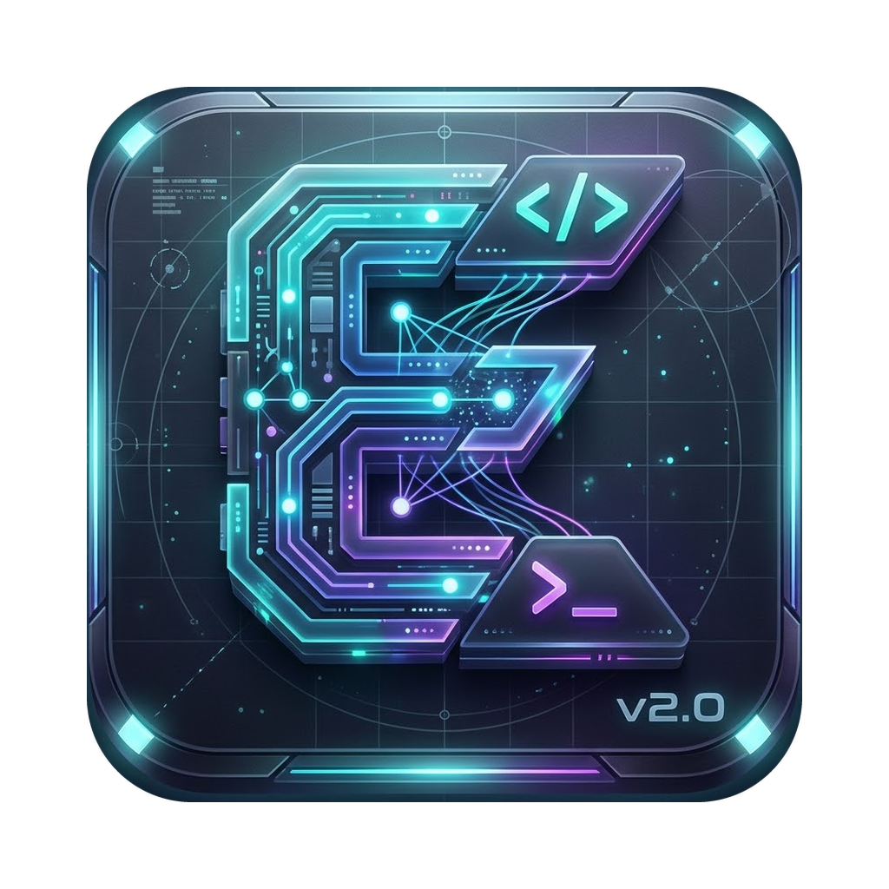

# Edy

<p align="center"></p>

Лёгкая агентная ИИ-панель для macOS на Go. Архитектура и принятые решения описаны в
[docs/ARCHITECTURE.md](docs/ARCHITECTURE.md).

Сейчас готов **OmniRoute** — локальный OpenAI-совместимый прокси с ротацией ключей,
шифрованием секретов и дневным бюджетом. Он работает с OpenAI-совместимыми API, с Anthropic
и с терминальными утилитами (Ollama, Claude Code, Aider) через PTY.

## Приложение (окно на Wails)

Собирается на Mac — нужны Go (`brew install go`) и Xcode Command Line Tools (`xcode-select --install`):

```sh
git clone -b claude/elegant-edison-gu1b8f https://github.com/laurenwilcox/name.git edy
cd edy
scripts/build-macos-app.sh
open build/Edy.app            # или: rm -rf /Applications/Edy.app && cp -R build/Edy.app /Applications/
```

## Интерфейс в браузере

```sh
edy ui
```

Запускает OmniRoute и открывает интерфейс в браузере. В нём можно управлять провайдерами и ключами, ставить CLI-утилиты, смотреть расходы и задавать дневной лимит, а также узнать адрес и токен для внешних программ.

## Быстрый старт из терминала

```sh
go build -o edy ./cmd/edy

# Anthropic
./edy provider add -name anthropic -kind anthropic -models claude-opus-5-5,claude-haiku-5-5 -price-in 4 -price-out 20
./edy key add -provider anthropic -label main      # ключ вводится в stdin

# Любой OpenAI-совместимый API, например локальная Ollama (ключ не нужен)
./edy provider add -name ollama -kind openai -base-url http://localhost:11434/v1 -models llama3.1

# Терминальные агенты через виртуальный терминал (PTY)
./edy provider add -name ollama-cli -kind cli -preset ollama -models llama3.1
./edy provider add -name claude-cli -kind cli -preset claude-code -models sonnet
# Google Antigravity: модели Claude и Gemini по подписке Google (имена моделей — из `agy models`)
./edy provider add -name agy -kind cli -preset antigravity -models "Claude Opus 5.5 (Thinking)"

./edy budget set 5      # не больше $5 в день
./edy serve             # http://127.0.0.1:11435/v1
```

Запрос:

```sh
curl http://127.0.0.1:11435/v1/chat/completions \
  -H "Authorization: Bearer $(./edy token)" \
  -H "Content-Type: application/json" \
  -d '{"model":"anthropic/claude-opus-5-5","stream":true,"messages":[{"role":"user","content":"Привет!"}]}'
```

Любая программа, которая умеет работать с OpenAI API, подключается так:
base URL `http://127.0.0.1:11435/v1`, ключ — токен из `edy token`
(он также лежит в `~/Library/Application Support/Edy/router.token`).

## MCP: инструменты Edy для Claude Code, Gemini CLI, Cursor

```sh
# Claude Code в папке проекта
claude mcp add edy -- edy mcp -project "$PWD"
```

Агент получает карту проекта, поиск по коду, правку файлов внутри проекта, проверки и скиллы. Каждая правка —
снимок в Shadow Git. Готовые команды и JSON для других клиентов — в интерфейсе, экран «Подключение».

## Тесты

```sh
go test ./...
```

## Автор

**Vollo** ([@laurenwilcox](https://github.com/laurenwilcox)) — автор и владелец проекта.

## Лицензия

[MIT](LICENSE) © 2026 Vollo
